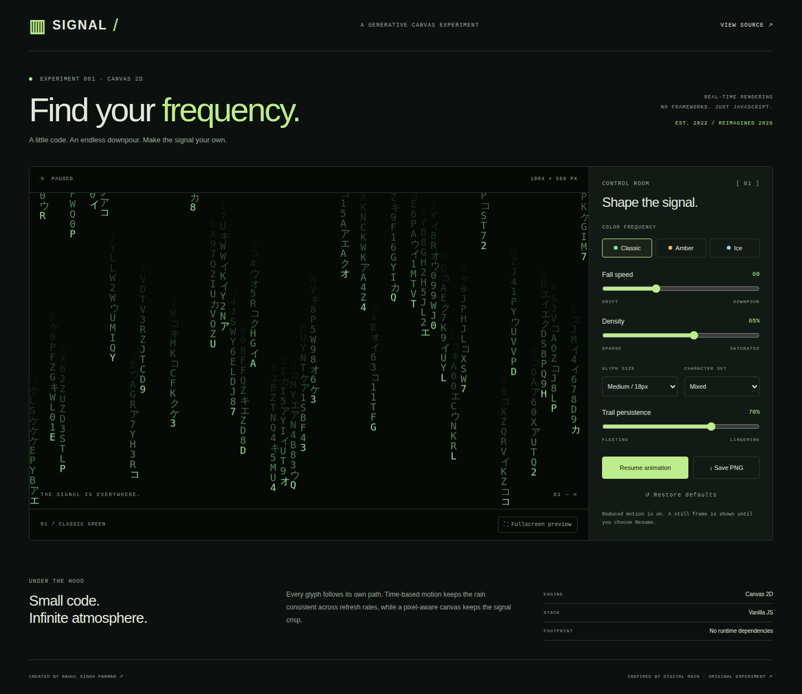
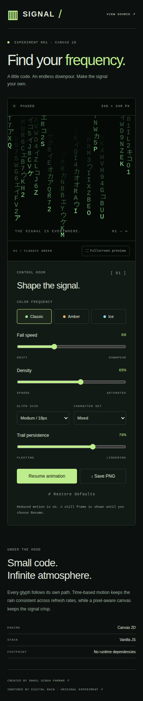

# Signal / Matrix Rain Studio

[Live demo](https://rahulsinghparmar.github.io/rahul_matrix_js/) · [Frontend checks](https://github.com/RahulSinghParmar/rahul_matrix_js/actions/workflows/quality.yml) · [Design case study](docs/CASE-STUDY.md)

An interactive digital rain playground built with Canvas 2D and vanilla JavaScript. Tune the rain, explore color frequencies, pause the moment and export a PNG — all in your browser.



## Features

- Classic green, amber and ice palettes, with Latin, binary, Katakana or mixed glyphs.
- Controls for speed, density, glyph size and trail persistence.
- Pause/resume, reset, fullscreen where supported, and PNG export.
- Time-based movement with stable per-particle velocity, rather than frame-count-dependent animation.
- Responsive canvas with device pixel ratio support capped at 2 to limit rendering cost.
- Saved, validated preferences. The app works when local storage is blocked.
- Reduced motion starts with a still frame; animation requires explicit opt-in. Hidden tabs suspend rendering.
- Accessible native controls, visible keyboard focus, skip navigation and a responsive layout.

## Screenshots



Screenshots capture the implemented app, not design mockups. The showcase test uses reduced motion for a still preview. Mobile captures show the full scrollable layout.

## Run and test

Use Node.js 22.13+ for development tooling:

```sh
npm ci
npm start
```

Open http://127.0.0.1:4173. No framework, remote font, analytics or runtime dependency is loaded by the app. ES modules require serving files over HTTP.

```sh
npm run lint
npm run format:check
npm test
npx playwright install chromium firefox webkit
npm run test:e2e
```

Unit tests verify settings validation, character selection and frame-rate-independent movement. Browser tests check controls, persistence, pause stability, reset, reduced motion, blocked storage, PNG downloads and horizontal overflow in Chromium, Firefox, WebKit and mobile Chromium emulation. Physical-device and assistive-technology checks remain valuable.

## How it works

`settings.js` contains validated settings, palettes, glyph selection and the pure motion calculation. `matrix.js` owns the canvas lifecycle and interaction. Each particle gets a position and stable velocity; elapsed seconds determine movement. Trail fading is adjusted by elapsed time. Resizing reseeds the distribution and resets the canvas transform. The PNG is generated locally with Canvas.toBlob.

Fullscreen depends on browser/device support; a status message explains when unavailable. Output is generative, so screenshots vary. The canvas is decorative with an accessible description; controls are real HTML elements.

## Deployment

GitHub Actions checks formatting, lint, unit and browser tests before publishing public assets to GitHub Pages. Set Pages source to GitHub Actions. Pull requests never deploy.

## Attribution and license

This repository began as a fork of [tarantino07/ytb_matrix_js](https://github.com/tarantino07/ytb_matrix_js). That origin is credited here and in the interface. The studio is a new implementation by [Rahul Singh Parmar](https://github.com/RahulSinghParmar), including the renderer, controls, responsive design and tests.

The upstream snapshot has no declared license. The [MIT license](LICENSE) applies to the new studio implementation, not upstream code retained in Git history. No affiliation with The Matrix franchise is claimed. See [contributing](CONTRIBUTING.md) and [security](SECURITY.md).
